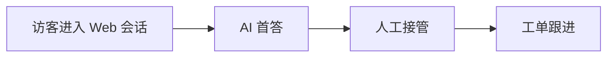

# Mermaid Compatibility

The repository's documentation site has switched to VitePress and enabled `vitepress-plugin-mermaid`. ` ```mermaid ` code blocks in Markdown participate in site rendering, but for readability and long-term maintainability, the constraints below must still be followed.

## Current Constraints

- Diagrams that need faithful long-term preservation should provide both:
  - the Mermaid source block
  - a corresponding textual step-by-step explanation
- When adding a Mermaid diagram in a review or PR, `npm -C docs run build` must be run locally first
- If the diagram is critical delivery content, prefer attaching an exported PNG/SVG to `docs/public/`

## Recommended Writing Style

1. First write a plain-text section explaining the flow, node meanings, and key branches
2. Mermaid serves only as auxiliary expression and does not carry the sole information source
3. Keep diagram size under control; avoid extra-wide layouts and overly deep nesting
4. Use short phrases for node labels; avoid overly long mixed Chinese-English text that makes line wrapping uncontrollable

## Minimal Example

The example below is used to verify the Mermaid rendering chain in the current VitePress site:



## Future Evolution

- Keep adding:
  - a Mermaid version and plugin version pinning policy
  - dark/light theme readability verification
  - a minimal CI Mermaid rendering smoke case
