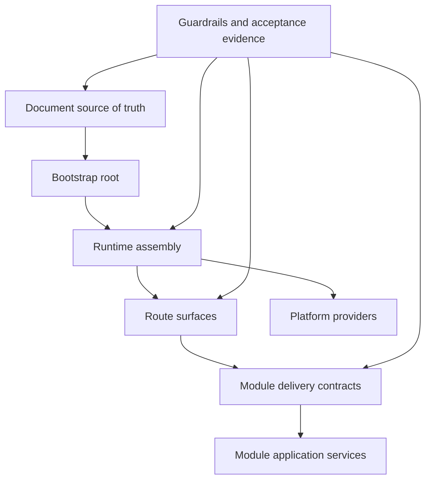

> **English** | [中文](architecture-redesign-plan.md)

# Architecture Redesign Plan

> ⚠️ **Snapshot note (2026-10-04 doc reconciliation)**: This is the execution framework for the services→modules migration period. Its core goals (closing the services/modules boundary, stabilizing the runtime assembly / router / provider structure) have been delivered in subsequent batches: `internal/services` has been removed entirely, and all business capabilities are closed out under `internal/modules/*` (capped at 27 modules). The current authoritative architecture snapshot is [current-architecture.md](./current-architecture.md); the V1.0 spec is [v1-convergence-plan.md](./v1-convergence-plan.md). This document is archived as migration history only.

This is the execution framework for the next round of architecture redesign. It does not enumerate a new feature backlog. The goal is to first align the doc spec, current architecture, migration order, and acceptance rules, before deciding on specific code changes.

## Goals

This round of redesign prioritizes solving four classes of problems:

1. Stop conflating the current real architecture with the target architecture.
2. Continue contracting the boundary between `services` and `modules`.
3. Split runtime assembly, router surface, and provider boundary into maintainable, stable structures.
4. Bind redesign results to executable checks and acceptance evidence, rather than leaving them in design docs only.

## Non-goals

Currently not doing:

- Do not split the backend into microservices.
- Do not rewrite every handler or every service.
- Do not use architecture redesign to substitute for closing the current P1 acceptance.
- Do not expand new product capabilities to mask evidence gaps in the existing main path.

## Design spine



## Phase 0 Document baseline

Finish doc organization first, so subsequent code changes share a common context.

Deliverables:

- `docs/current-architecture.md`
- `docs/architecture-redesign-plan.md`
- Fill in doc-site navigation for `09` through `12` and the `10-*` migration governance docs
- Update the reading order in `docs/implementation/README.md`

Acceptance:

- Reach current architecture, target architecture, redesign plan, and module migration governance directly from the doc site.
- Every subsequent task can point to one clear source of truth.

## Phase 1 Runtime assembly closeout

Goal: keep `internal/app/server` as the assembly root, but prevent cross-domain logic from piling back into a single file.

Already done:

- `router.go` has been split out auth / management / public / realtime.
- `runtime.go` has been split into `runtime_assembly.go` plus several dedicated runtime files.

Next:

- Establish a naming rule for assembly helpers: `wire<Capability>Runtime` only wires dependencies, does not write business rules.
- Continue confining worker-only concrete services to the worker accessor.
- Keep cross-domain runtimes like realtime / voice / AI behind a dedicated runtime contract; do not expose concrete hub/provider to handlers.

Acceptance:

- Adding a route surface does not require touching unrelated runtime helpers.
- Adding a module handler by default touches only module delivery, runtime assembly, and the corresponding router surface.

## Phase 2 Module boundary tightening

Goal: push already-closed modules from "contracted/stabilized" to "legacy service can be retired or explicitly retains a responsibility."

Priority order:

1. Capabilities that already have a delivery main path but still keep a facade.
2. Capabilities where `services` still carries subscriber or runtime glue.
3. Atypical migration areas like realtime / voice.

Execution rules:

- New business logic goes into `modules/*/application` first.
- Handlers consume only `modules/*/delivery` or a handler-local contract.
- If a legacy service has no necessary runtime responsibility, delete it; do not keep an empty-shell facade.

Acceptance:

- `scripts/check-module-boundaries.sh` covers newly stabilized modules.
- `docs/implementation/10-migration-scorecard.md` stays consistent with the rules file.

## Phase 3 Provider boundary closeout

Goal: make the dev/demo/prod provider boundary explicit so mock, disabled, and compatibility do not mix into default production semantics.

Key areas:

- event bus: `inmemory` vs `redis` runtime boundary
- AI / knowledge: Dify, WeKnora compatibility, pgvector, custom provider
- voice: disabled, mock, Twilio, Deepgram
- storage: local filesystem vs future S3/MinIO
- session IP intelligence: heuristic vs HTTP provider

Acceptance:

- Production config templates do not implicitly enable mock providers.
- Health checks and baseline checks expose provider state.
- Docs make explicit that a compatibility provider is not the default product main path.

## Phase 4 Route surface and permission governance

Goal: make route surfacing an architectural constraint, not just a file split.

Current surfaces:

- auth
- management
- public
- realtime
- static

Next:

- Every new route must first select a surface.
- The management surface goes through auth, scope, principal kind, permission, and audit by default.
- The public surface must be registered in the security surface catalog and have a path-level rate-limit policy.
- The service-only surface must not be mistakenly reused by management permissions.

Acceptance:

- Route security warnings no longer rely on human memory.
- New public routes that lack registration or rate limiting can be caught by a check.

## Phase 5 Product workflow alignment

Goal: converge the architecture around the main product path (see V1 scope in [v1-product-scope.md](./v1-product-scope.md)):

```text
Web 接入 -> AI 首答 -> 人工接管 -> 转接协作 -> 工单全流程
```

Remote assistance is retained as an enhancement direction after `人工接管`, and does not enter V1 main-path acceptance. This V1 path involves:

- SDK session bootstrap
- conversation / realtime
- AI / knowledge provider
- routing / agent load
- ticket command/query
- audit / metrics / acceptance evidence

Acceptance:

- The main path's docs, API, SDK, admin entry, and acceptance checklist use the same terminology.
- The status in `docs/acceptance-checklist.md` can be traced back to real requests or runtime evidence.

## Phase 6 Verification closeout

Every architecture redesign task must be bound to at least one verification method:

- module boundary check
- route surface check
- Go unit or integration tests
- SDK smoke tests
- acceptance manifest
- docs build

Minimum completion spec:

1. Documentation updates complete.
2. Boundary rules or tests prevent regression.
3. The corresponding acceptance checklist or scorecard is updated in sync.

## Current next step

After doc organization is complete, prioritize continuing the current recovery point in `todo.md`:

- `P1-1 AI / Knowledge 验收收口`

In parallel, maintain module migration governance:

- Keep `10-migration-scorecard.md` consistent with `scripts/module-boundaries.rules`.
- Annotate retained legacy services with their retention reason and retirement conditions.
