# Survey of Similar Online Customer Service Products: Features, Interfaces, and Interactions

Survey date: 2026-10-08. Sample of 12 vendors, 8 international (Intercom, Zendesk, Crisp, tawk.to, Tidio, LiveChat, HubSpot, Drift) and 4 domestic (Meiqia, Zhichi, NetEase Qiyu, Easemob). Features and pricing are based on each vendor's official site and official help center pages as of that day; screenshots were all taken live in a browser that day, embedded at the corresponding positions below, with the original files stored in `docs/zh/research/assets/`.

**One-sentence overview**: the chat widget, agent workspace, bot/AI, and notification unread are already full-standard entry thresholds across all 12 vendors; the real differentiation lies in tickets (8 have it, 2 put it in paid tiers, 2 don't do it), AI pricing models (per-resolution/per-session/bundled), and theme customization depth; the transferable surface for servify converges on "script embedding + de-facto-standard configuration items + mobile auto-avoidance", see [Section IV Reference Analysis](#iv-reference-analysis).

---

## I. Feature List

Conclusion first: **chat widget 12/12, agent workspace 12/12, bot or AI 12/12, notification unread 12/12** — these four are already standard and do not constitute selection differences; **tickets diverge the most** (8 have it, 2 put it in paid tiers, 2 don't do it — LiveChat and Drift simply don't have them), making them the differentiation slot; theme customization is standard at 9 vendors with 3 in paid tiers, and data dashboards are standard at 11 — both are "expected capabilities" that add no points when done and subtract when not. servify v1's feature surface (conversation + tickets + AI + knowledge base) is on par with the mid-tier products in the sample.

Legend: ✔ has it; ◐ has it but tiered/paid; — not seen on the collected pages.

| Product | Chat Widget (Visitor Side) | Agent Workspace | Tickets | Bot/AI | Multi-Channel | Theme Customization | Notifications/Unread | Data Dashboard |
|---|---|---|---|---|---|---|---|---|
| Intercom | ✔ Messenger | ✔ Inbox | ✔ | ✔ Fin ($0.99/resolution) | ◐ WhatsApp/SMS/phone metered billing | ✔ Launcher+Home configurable | ✔ | ✔ Built-in reports, real-time dashboard in Expert |
| Zendesk | ✔ Web Widget | ✔ | ✔ Core capability | ✔ AI Agents | ✔ | ✔ Position/rounded corners/three colors/Logo | ✔ Sound alerts | ✔ |
| Crisp | ✔ | ✔ Shared inbox | ◐ Plus tier | ◐ AI Chatbot included in tier | ◐ All channels from Essentials | ✔ | ✔ Push | ◐ Advanced analytics in Plus tier |
| tawk.to | ✔ | ✔ | ✔ | ✔ Apollo+AI Assist | ✔ | ✔ Color/position/greeting | ✔ Push + desktop/mobile App | ✔ |
| Tidio | ✔ | ✔ | ✔ | ✔ Lyro | ✔ WhatsApp/Instagram/Messenger | ✔ | ✔ | ✔ Unified reports |
| LiveChat | ✔ | ✔ Inbox | — | ✔ AI Agent + AI toolset | ◐ | ✔ Live Editor | ✔ | ✔ Reports |
| HubSpot | ✔ Free | ✔ Conversation inbox | ✔ | ✔ Free Chatbot Builder | ◐ | ✔ | ✔ Slack + mobile | ✔ |
| Drift | ✔ (retired) | ✔ | — | ✔ Started as conversational marketing | ◐ | ✔ | ✔ | ✔ |
| Meiqia | ✔ | ✔ | ◐ | ✔ LLM lead-gen bot | ✔ Website/Official Account/Douyin/Mini Program/APP | ✔ Highly customizable widget, iframe embedding | ✔ Multi-channel alerts | ✔ Data dashboard |
| Zhichi | ✔ | ✔ | ✔ Ticket channel | ✔ Integrates OpenAI/DeepSeek/Qwen/Wenxin Yiyan/Claude | ✔ Includes WhatsApp | ◐ | ✔ | ✔ |
| NetEase Qiyu | ✔ | ✔ | ✔ Includes email tickets, SLA | ✔ Logistics/refund agents | ✔ | ◐ | ✔ Message alerts | ✔ Custom reports + data screen |
| Easemob | ✔ | ✔ Efficiency workspace | ✔ Smart tickets | ✔ 7×24 bot (greeting/default/repeat/timeout/handoff configurable) | ✔ Online/mini program/APP/video/call center | ◐ | ✔ | ✔ Data screen + intelligent QA |

A few facts worth recording separately:

- **Tickets are positioned differently domestically and abroad.** Zendesk treats tickets as the backbone, with online chat as just one entry point; Crisp only gives tickets in its most expensive Plus tier ($295/month); Qiyu and Zhichi build tickets as an internal "first-line/second-line collaboration" flow tool, bound together with SLA and satisfaction ratings ([Qiyu ticket page](https://b.163.com/home/qiyu/worksheet)).
- **AI pricing models have already diverged.** Intercom's seat prices $29/$85/$132 (annual billing) plus Fin at $0.99/resolution; the company's own line is "when AI usage is high, this part exceeds the seat fee" ([pricing guide](https://www.intercom.com/learning-center/intercom-pricing)); Tidio tiers by "billable conversation count", Free 50, Starter from $24.17/month ([pricing page](https://www.tidio.com/pricing/)); Zendesk bundles AI into seat prices, $19/$55/$115 per agent per month (annual billing) ([pricing page](https://www.zendesk.com/pricing/)).
- **tawk.to's free tier is not a subsidy, it's the business model.** Agent count, conversation count, and site count are all unlimited; revenue comes from add-on packs sold per "site" (the "remove branding from $29/month" figure comes from third-party reviews; the official line is in [why-free](https://www.tawk.to/why-free/)).
- **Drift has already exited.** drift.com's homepage now directly says "We've transitioned from Drift to 1mind"; Salesloft announced on 2026-03-06 that it would gradually shut down and direct customers to 1mind ([drift.com](https://www.drift.com/)). The sample of lead-gen chatbots loses one member; it is kept because it proves that the "pre-sales conversation only" line cannot sustain a standalone product.
- **The common structure of the four domestic vendors** is the four-piece set of "online customer service + tickets + bot + call center", each adding one specialty: Qiyu adds QA and report screens, Easemob adds video customer service and mini programs, Zhichi adds overseas expansion and WhatsApp, and Meiqia puts its narrative on lead generation (the homepage is all about lead-capture cards, business cards, and leads; the product intro says "complete website code deployment in 3 minutes") ([meiqia.com](https://www.meiqia.com/)).

---

## II. Interface Screenshots

All taken live in a browser on 2026-10-08; the original files are in `docs/zh/research/assets/`.

The patterns within this section, stated up front: **official product pages generally place a side-by-side "chat widget + agent workspace" image**, with the visitor side at the bottom-right and the agent side taking up the large area (HubSpot, Qiyu, and Zhichi all use this composition); the ones that actually photograph the **configuration interface** are Intercom's Messenger setup docs and Zendesk's developer docs; **pricing page structures are highly convergent** — tier cards on the left, feature checkmark table on the right (Crisp's four-column table is the most typical: chat widget/inbox/mobile App/SDK/Push in the free tier, tickets/white-label/advanced analytics pushed to Plus).

### Intercom

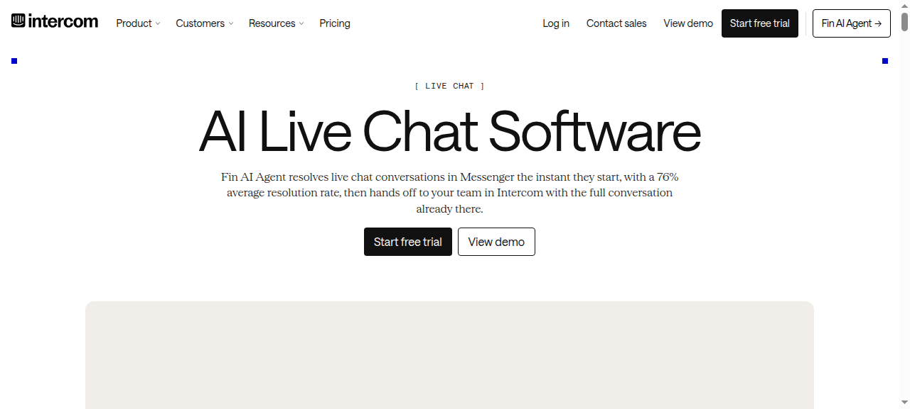
`intercom-live-chat.png` — [intercom.com/live-chat](https://www.intercom.com/live-chat). Product page hero visual, corresponding to the Messenger and Fin rows in the feature list.

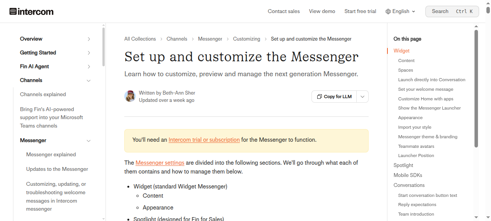
`intercom-messenger-docs.png` — [Messenger setup docs](https://www.intercom.com/help/en/articles/6612589-set-up-and-customize-the-messenger). The highest-information screenshot in this batch: the right-hand page outline shows the configuration groups under Widget — Content / Spaces / Appearance / Import your style / Messenger theme & branding / Launcher Position — which is the source of the "de-facto standard list" in Section III 3.3.

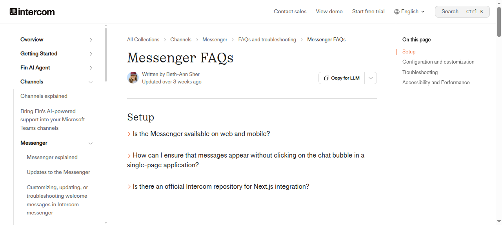
`intercom-messenger-faqs.png` — [Messenger FAQs](https://www.intercom.com/help/en/articles/6612597-messenger-faqs). The source of the requirement that SPA route changes must call `Intercom("update")` (Section 3.2).

### Zendesk

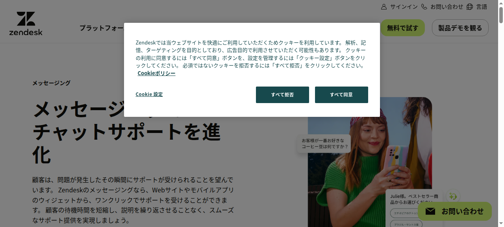
`zendesk-messaging.png` — [zendesk.co.jp/service/messaging](https://www.zendesk.co.jp/service/messaging/) (zendesk.com redirects to the Japanese site by visitor IP; kept as-is).

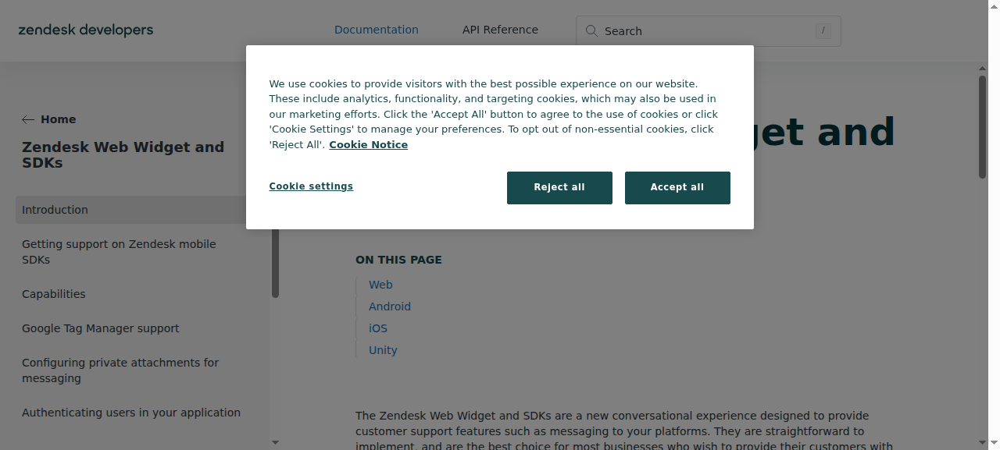
`zendesk-widget-docs.png` — [developer.zendesk.com](https://developer.zendesk.com/documentation/zendesk-web-widget-sdks/). The first screen is blocked by a cookie consent popup; the visible part is the SDK chapters for Web/Android/iOS/Unity — the product form of Web Widget and mobile SDK in parallel (the third depth in Section 3.1).

### Crisp

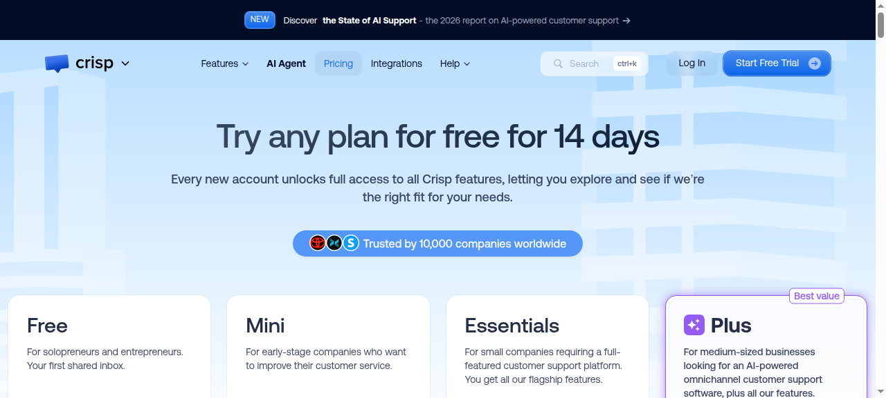
`crisp-pricing.png` — [crisp.chat/en/pricing](https://crisp.chat/en/pricing/). A typical sample of the converging pricing-page structure: tier cards + feature checkmark table, tickets in the Plus tier.

### tawk.to

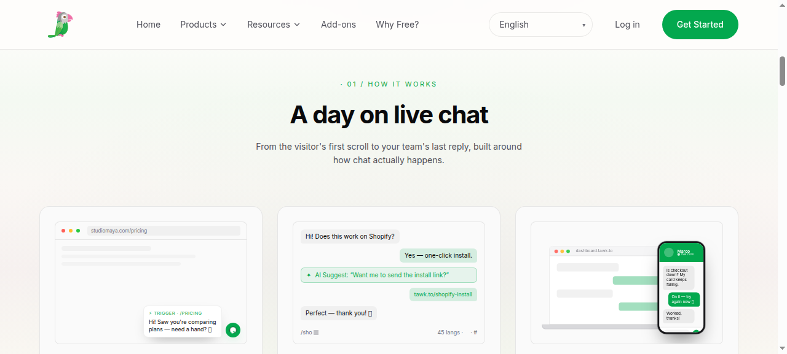
`tawk-live-chat.png` — [tawk.to/products/live-chat](https://www.tawk.to/products/live-chat/). The source of script embedding, the 50+ platform one-click installers, the 6 preset positions, and the trigger greeting (Sections 3.1/3.2/3.3).

### Tidio

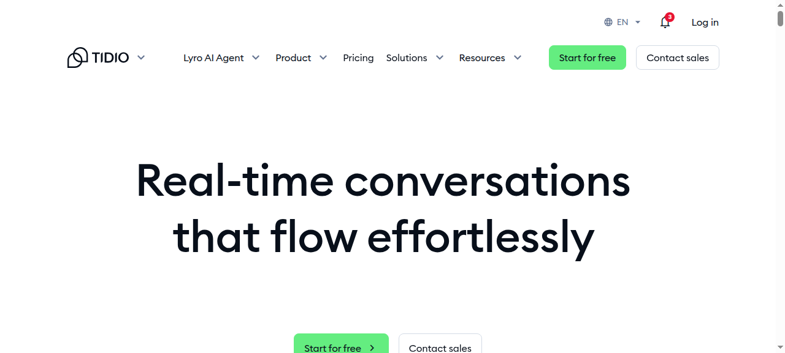
`tidio-live-chat.png` — [tidio.com/live-chat](https://www.tidio.com/live-chat/). The source of the Lyro AI and the "open the widget on entry" script.

### LiveChat

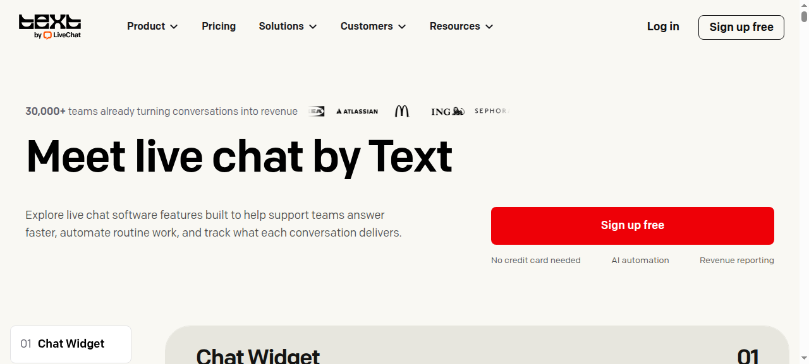
`livechat-features.png` — [livechat.com/features](https://www.livechat.com/features/). The source of the Live Editor WYSIWYG customization and Reports (the only formal product in the sample without tickets).

### HubSpot

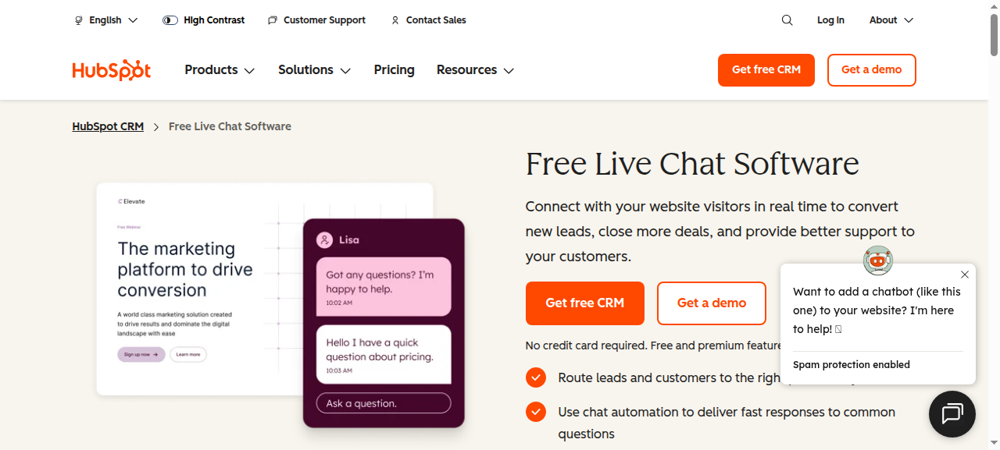
`hubspot-live-chat.png` — [hubspot.com/products/service/live-chat](https://www.hubspot.com/products/service/live-chat). The side-by-side "chat widget + agent workspace" composition of the free chat widget + conversation inbox.

### Drift

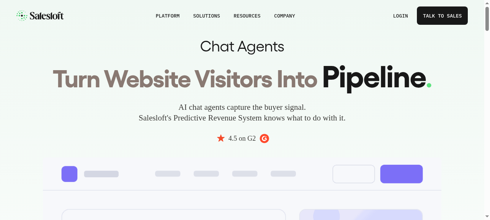
`drift-home.png` — [drift.com](https://www.drift.com/). The homepage directly says "We've transitioned from Drift to 1mind" — the original evidence of the exit statement.

### Meiqia

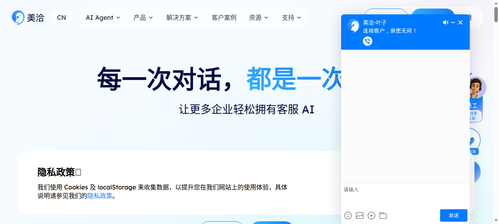
`meiqia-home.png` — [meiqia.com](https://www.meiqia.com/). The narrative is on lead generation: lead-capture cards, business cards, leads, "complete website code deployment in 3 minutes".

### Zhichi

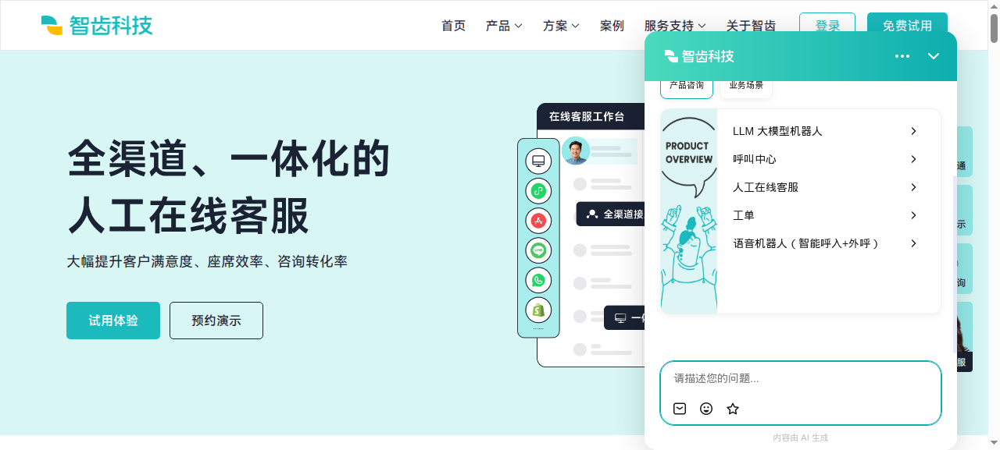
`zhichi-livechat.png` — [zhichi.com/livechat](https://www.zhichi.com/livechat/). A domestic sample of the side-by-side "chat widget + agent workspace" composition, multi-channel including WhatsApp.

### NetEase Qiyu

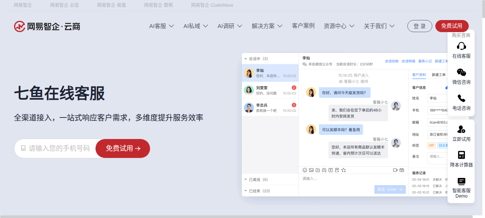
`qiyu-online-kefu.png` — [b.163.com/home/qiyu/onlinekefu](https://b.163.com/home/qiyu/onlinekefu). The product narrative of the data-screen reports and QA specialty.

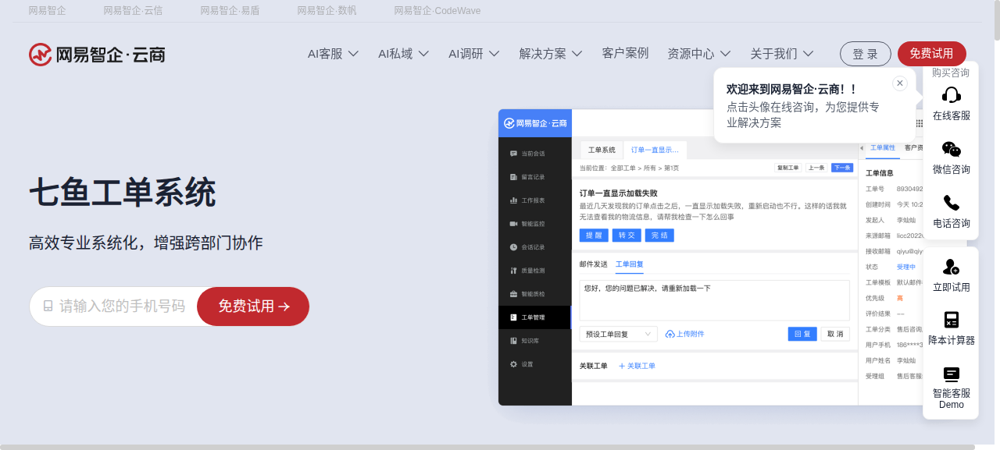
`qiyu-worksheet.png` — [b.163.com/home/qiyu/worksheet](https://b.163.com/home/qiyu/worksheet). The source of the "ticket three-piece" minimal closed loop in Section IV (multi-channel creation / association and preset replies / satisfaction rating).

### Easemob

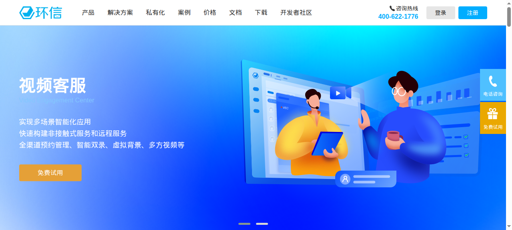
`easemob-cs.png` — [easemob.com/product/cs](https://www.easemob.com/product/cs). The source of the efficiency workspace, data screen + intelligent QA, and the five configurable bot items (greeting/default/repeat/timeout/handoff).

---

## III. Human-Computer Interaction Points

### 3.1 Embedding Methods

Three depths, corresponding to three integration costs:

1. **A single `<script>`.** tawk.to's install docs are just an async script pasted into the page, plus one-click installers for 50+ platforms like Shopify/WordPress/Wix ([live-chat page](https://www.tawk.to/products/live-chat/)); Tidio's official docs likewise require the script before the `</body>` closing tag and provide a complete copy-paste snippet ([help docs](https://help.tidio.com/hc/en-us/articles/5464289229340-Opening-the-widget-automatically)); Meiqia's site says "complete website code deployment in 3 minutes" ([meiqia.com](https://www.meiqia.com/)).
2. **Client-side JS API.** Zendesk's Web Widget API allows changing the widget's settings and display on specific pages without touching the backend config ([developer docs](https://developer.zendesk.com/documentation/zendesk-web-widget-sdks/)); tawk.to uses the `customStyle` method for pixel-level offsets, and it must be defined before the embed script to take effect ([position docs](https://help.tawk.to/article/changing-the-widget-position)); Tidio exposes `window.tidioChatApi`, and `open()` remotely opens the window.
3. **SDK and iframe.** Intercom's Messenger requires an SDK on mobile (iOS v15.2.0, Android, React Native, Cordova each with different version numbers) [Messenger FAQs]; Zendesk has Android/iOS/Unity SDKs in addition to the Web Widget; Meiqia's site lists "highly customizable widget" and "iframe embedding" as open capabilities.

### 3.2 Open Flow

- The default flow is "collapsed into a bubble → click to expand → first screen is Home or a greeting". Intercom splits this layer into two concepts: Launcher (the bubble) and Messenger Home (the space of the first open); the six spaces Home, Messages, Tickets, Help, News, Tasks are drag-sortable, and Messages cannot be closed ([Messenger setup docs](https://www.intercom.com/help/en/articles/6612589-set-up-and-customize-the-messenger)).
- Proactive opening is standard for lead-gen products: tawk.to's triggers fire greetings by URL, behavior, and source page ([live-chat page](https://www.tawk.to/products/live-chat/)); Tidio's approach is the most direct — the official docs provide an "open the widget on entry" script, in desktop and mobile variants; LiveChat's Campaigns and Meiqia's "proactive invite by dwell time / key page" are the same class of capability.
- SPAs share a common pitfall: Intercom requires calling `Intercom("update")` on every route change, otherwise messages don't surface on their own ([Messenger FAQs](https://www.intercom.com/help/en/articles/6612597-messenger-faqs)).

### 3.3 Bubble Styles

The configurable items have converged into a de-facto standard:

- **Position**: tawk.to offers 6 preset positions on desktop (top/middle/bottom × left/right), selectable in the admin without writing code, plus code-level fine-tuning ([position docs](https://help.tawk.to/article/changing-the-widget-position)); Zendesk offers only bottom-left/bottom-right, with a default 16px margin offset.
- **Color and shape**: Zendesk's Style page can set the primary color (bubble and top bar), message color, action color, a 0–20px border-radius slider, plus Logo, title, description, attachment toggle, and sound alerts ([appearance config docs](https://support.zendesk.com/hc/en-us/articles/4500747797914-Configuring-the-name-and-appearance-of-the-Web-Widget)).
- **How to change**: LiveChat's Live Editor edits directly on the real site, with a right-hand preview split into desktop/mobile views, and separate themes for the "collapsed" and "expanded" states, no CSS required ([customization docs](https://www.livechat.com/help/customize-your-chat/)).

### 3.4 Mobile Adaptation

- The 6 desktop positions don't carry over to mobile: tawk.to's position docs state the presets are only for desktop and laptop; on mobile the widget automatically repositions to avoid the site navigation ([position docs](https://help.tawk.to/article/changing-the-widget-position)).
- Some products simply allow turning off the web widget on mobile and going through the App instead: LiveChat's configurator can disable the widget based on whether the visitor is on a mobile device ([customization docs](https://www.livechat.com/help/customize-your-chat/)); tawk.to uses native iOS/Android Apps + Push to carry offline conversations ([live-chat page](https://www.tawk.to/products/live-chat/)).
- Mobile chat widgets are basically full-viewport page forms; the desktop is the small card in the bottom-right corner; the four domestic vendors generally run "web widget + mobile workspace App" as two parallel lines, with the agent side and visitor side adapted separately.

---

## IV. Reference Analysis

Each item gives a conclusion, rationale, and this repo's landing point. Conclusions fall into three tiers: **Reference-worthy** (copy directly or already aligned), **Borrowable** (the idea is sound, adapt to this repo's form), and **Not applicable** (conflicts with this repo's delivery form/boundaries). Overall judgment: the visitor-side chat widget's configuration surface and interaction paradigm have been converged by the sample into a de-facto standard, and this repo's v1 appearance/theme orders (C1-1/C1-2) fall within the standard; the real open gaps are **JS API depth** (changing position/open-close/theme in-page) and **proactive operation triggers**, both of which have landing-point suggestions.

| # | Conclusion | Item | Why | Where it lands in this repo |
|---|---|---|---|---|
| 1 | Reference-worthy | A single `<script>` as the entry-level embed, JS API to follow | 9 of the 12 vendors make a single script the entry action; admin config covers 80% of scenarios, and the remaining 20% must be changeable in-page with a documented "code-level overrides admin-level" priority (tawk.to `customStyle` and Zendesk's per-page config both prove this) | todo **C1-4 Integration Guide** (`docs/embedding-guide.md` already has the script-embed surface); a section explaining the "code-level overrides admin-level" priority is recommended in the guide |
| 2 | Reference-worthy | Bubble configuration items follow the de-facto standard, don't invent your own | Position (6 presets or bottom-left/bottom-right), primary/message/action colors, 0–20px border radius, greeting, Logo/title/description, sound alerts — LiveChat's and Zendesk's docs are exactly this list | todo **C1-1 Component Appearance Configuration Surface** is landed (icon three tiers/primary color/border radius/floating position four corners/size), aligned with the standard; the only gap, "6 preset positions vs this repo's four corners", can be a follow-up fine-tuning |
| 3 | Reference-worthy | Mobile widget auto-repositions to avoid site navigation | Of the three paths (full viewport / turn off and go through the App / auto-avoidance), tawk.to's auto-avoidance is the lowest cost, with no device detection needed | todo **C1-3/C1-4** (the two-style test page already includes the 375 variant; the mobile section of the embedding guide spells out the avoidance strategy); the `widget-mobile.html` prototype is the bottom-sheet form |
| 4 | Reference-worthy | Two theme sets for collapsed/expanded states | LiveChat's separate "collapsed" and "expanded" themes are standard practice | This repo's **C1-2 already has two independent light/dark configurations** (following the host site or manually specified), already covered; revisit this item if "per-trigger-scenario themes" are supported later |
| 5 | Reference-worthy | SPA route changes must sync widget state | Intercom's pitfall (messages don't surface without calling `update`) is one every SPA embedder will hit; writing it into the guide early saves one support cost | Add an "SPA route sync" section to `docs/embedding-guide.md` (recommended to register as a todo C1-4 note) |
| 6 | Reference-worthy | Ticket minimal closed loop: conversation-to-ticket + flow + SLA + satisfaction rating | The minimal closed loop given by Qiyu's ticket page matches this repo's v1 scope | **Already in this repo**: the ticket main closed loop todo P1-5 is closed (five-state transition table in `docs/ticket-workflow.md`); the SLA model is in `models.go` (SLAConfig/SLAViolation); conversation association via `session.TicketID`. For acceptance comparison, no new development needed |
| 7 | Borrowable | Launcher (bubble) and Messenger Home (first-screen space) as two separate concepts | Modeling the "entry" and the "space after the entry" separately, with the Home space drag-sortable — more extensible than the coarse-grained "one chat widget" model | `docs/design/prototypes-v1/screens/widget-fab.html` (floating ball three states) + todo C1-2 brand slot; if a "first-screen space" (greeting/quick entries/history session sections) is built later, follow this model |
| 8 | Borrowable | Configuration panel grouped by Content/Appearance/Install/Security | Intercom Messenger settings' four groupings split "content/appearance/install/security", minimizing the mental burden for integrators finding config items | The todo C1-1/C1-2 configuration-surface documentation grouping narrative can be organized by these four categories (the "Component and Chat Widget Theme" section of `docs/embedding-guide.md`) |
| 9 | Borrowable | Proactive widget-open triggers (by URL/behavior/source page/dwell time) | Standard capability for lead-gen products; still valid for service products used as "proactive invite on key pages" | Register as a todo C1 follow-up enhancement (trigger configuration surface); the current repo widget has no such surface, does not block the ferry integration |
| 10 | Borrowable | Disable the web widget by visitor device (go through the App instead) | A one-line config-level capability; this repo's mobile side already has a native SDK session page, and the "web widget or App, pick one" strategy aligns with this practice | The mobile section of `docs/embedding-guide.md` states "mobile prefers the SDK session page; the widget can be disabled as needed" (register as a todo C1-4 note) |
| 11 | Borrowable | Drift's exit lesson: pre-sales lead-gen alone cannot sustain a standalone product | The samples that can charge long-term (Intercom, Zendesk, Zhichi, Qiyu) are all the complete "lead-gen + service + ticket" closed loop | The product boundary narrative in `docs/v1-product-scope.md` can cite this example (no new features, only as scope evidence) |
| 12 | Not applicable | AI per-resolution pricing (Fin $0.99/resolution) | servify is delivered as private deployment, with no per-resolution pricing surface; and even Intercom itself admits this model exceeds seat fees when usage is high — unpredictable cost is both a selling point and a risk | No landing point; cite as a counterexample only when the pricing narrative comes up |
| 13 | Not applicable | tawk.to's free model (selling add-on packs per site) | Different business model: this repo is delivered as private deployment, with no free-agents + site-add-on-pack structure | No landing point |
| 14 | Not applicable | LiveChat Live Editor (WYSIWYG editing on the real site) | Requires standalone editor infrastructure (injected preview + bidirectional sync), beyond the v1 and C1 order scope | Long-term observation; for now, "two-style verification on the test page" (todo C1-3, done) substitutes for the same goal |
| 15 | Not applicable | Zendesk's full per-page API surface overriding admin config | Item 1 already captures the "code-level overrides admin-level" priority principle; the complete per-page override API surface is an integration-depth question, not expanded in v1 | The minimal JS API surface (open/close/position) is merged into item 1's landing point; the rest is long-term |

---

## V. Sources

**International**

- Intercom pricing and features: [intercom-pricing](https://www.intercom.com/learning-center/intercom-pricing), [Messenger setup](https://www.intercom.com/help/en/articles/6612589-set-up-and-customize-the-messenger), [Messenger FAQs](https://www.intercom.com/help/en/articles/6612597-messenger-faqs), [live-chat product page](https://www.intercom.com/live-chat)
- Zendesk: [pricing](https://www.zendesk.com/pricing/), [Web Widget and SDK](https://developer.zendesk.com/documentation/zendesk-web-widget-sdks/), [name and appearance config](https://support.zendesk.com/hc/en-us/articles/4500747797914-Configuring-the-name-and-appearance-of-the-Web-Widget), [messaging product page](https://www.zendesk.com/service/messaging/)
- Crisp: [pricing and feature comparison table](https://crisp.chat/en/pricing/)
- tawk.to: [live-chat product page](https://www.tawk.to/products/live-chat/), [homepage](https://www.tawk.to/), [widget position docs](https://help.tawk.to/article/changing-the-widget-position), [why-free](https://www.tawk.to/why-free/)
- Tidio: [features page](https://www.tidio.com/features/), [pricing page](https://www.tidio.com/pricing/), [auto-open-widget docs](https://help.tidio.com/hc/en-us/articles/5464289229340-Opening-the-widget-automatically)
- LiveChat: [features page](https://www.livechat.com/features/), [widget customization](https://www.livechat.com/help/customize-your-chat/), [FAQ (pricing tiers)](https://www.livechat.com/help/frequently-asked-questions/)
- HubSpot: [free live chat product page](https://www.hubspot.com/products/service/live-chat)
- Drift: [drift.com](https://www.drift.com/) (merged into Salesloft/1mind)

**Domestic**

- Meiqia: [meiqia.com](https://www.meiqia.com/)
- Zhichi: [zhichi.com](https://www.zhichi.com/), [online customer service page](https://www.zhichi.com/livechat/)
- NetEase Qiyu: [online customer service](https://b.163.com/home/qiyu/onlinekefu), [ticket system](https://b.163.com/home/qiyu/worksheet)
- Easemob: [customer service cloud product page](https://www.easemob.com/product/cs)

**Note**: figures such as "15,000+ customers", "77.4% mobile market share", and "independently resolves 90% of common questions" are all self-reported by the vendors' official sites, not third-party verified; treat them as self-reported when citing.
