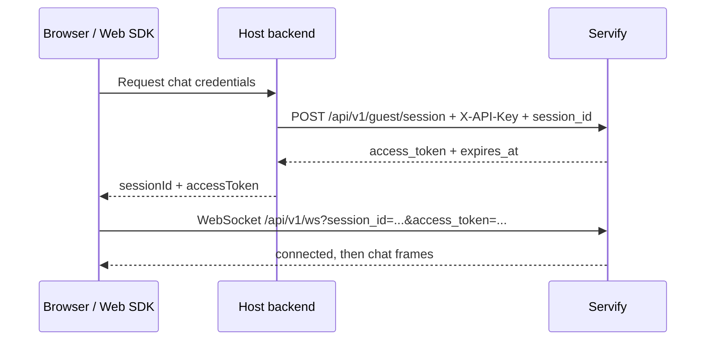

# Web SDK external integration

This guide describes the current Web SDK handoff for a third-party site. The
host application chooses a stable, non-secret `session_id`. A conversation row
is created when its first message is persisted; a separate session-creation
call is not required.

## Session and visitor token

When `security.guest_token.required` is enabled (recommended for authenticated
guest surfaces), the host backend obtains a short-lived token with its service
API key. Keep that key on the backend. Return only the session id and visitor
token to the browser.

| Step | Caller | Action |
|---|---|---|
| 1 | Browser → host backend | Request chat credentials for the signed-in/anonymous visitor. |
| 2 | Host backend → Servify | `POST /api/v1/guest/session` with `X-API-Key` and `{ "session_id": "site_<opaque-id>" }`. |
| 3 | Servify → host backend | Returns `access_token`, `token_type`, and `expires_at`; token is bound to that session. |
| 4 | Host backend → browser | Return `{ sessionId, accessToken }` over the site's authenticated HTTPS endpoint. |
| 5 | Browser → Servify | Initialize the SDK; it opens `/api/v1/ws` with `session_id` and `access_token`. |

The token defaults to a 24-hour lifetime (`security.guest_token.ttl` can
change it). A token for one session cannot authenticate another session. See
the full request example and credential guidance in
[`../docs/embedding-guide.md`](../docs/embedding-guide.md#32-visitor-token-the-ticket-for-authenticated-surfaces-like-feedback)
and the handshake contract in [`PROTOCOL.md`](PROTOCOL.md).

## Distribution status

The current source is an npm workspace, and the workspace root is marked
`private: true`. No public npm package or CDN script URL is published by this
repository. External consumers can use a source checkout/workspace dependency
or build a package tarball locally from the desired package; deployment teams
must publish the tarball to their own registry or host its built assets. There
is no supported `<script src="...">` URL today. A public registry release
requires a separate release decision and package publication.

The workspace requires Node.js 24 or later. Build with `npm ci && npm run build`
from `sdk/`; each package exposes its own package entry points and
build output under `packages/*/dist`.
